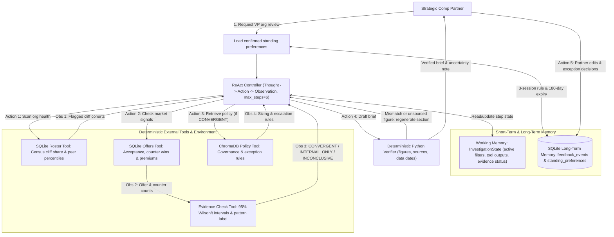

# Checkpoint 2.1: Reasoning loops, memory architecture, and tool usage

*Corrected on Oct 22, 2026, after grading. Section 3 now quotes the playbook's real 1.20 equity guideline rule, and Section 4 no longer says tool output keeps every step grounded. The graded copy on Canvas is unchanged.*

## System architecture diagram

## Written submission

### 1. Reasoning loop and evidence routing

The **Strategic Talent and Compensation Insight Advisor** runs a ReAct loop capped at six steps. Each thought picks one tool call in structured JSON, Python runs it, and the observation feeds the next thought. The loop tests the VP's concern before it prices anything. Models write the words, code computes the money, and people decide.

1. **Scan internal retention risk.** For a VP organization review, the roster tool returns only cohorts where 10 percent or more of employees face a cashflow drop of 15 percent or more, or sit below the 25th peer percentile.
2. **Cross-examine market friction.** For each flagged cohort, the offers tool returns new-hire acceptance, counter-offer win rates and competing premiums.
3. **Grade the evidence before retrieving policy.** The roster lists every employee, so a cohort's cliff share is a fact. The offers log holds 9 to 20 new-hire offers per job family, so each rate and average carries a 95 percent interval. An indicator counts as conclusive only when its whole interval clears the policy threshold. Evidence strength comes from these counts and intervals, never from the model's own confidence, which can run high on a wrong answer. The check labels the pattern and routes the next thought:
   - **`CONVERGENT`, a cliff backed by conclusive market pressure.** The agent retrieves sizing rules and drafts costed options.
   - **`INTERNAL_ONLY`, a cliff in a calm market.** The agent drafts a monitoring brief with no spend and sends high performers below the 25th percentile to refresh planning.
   - **`INCONCLUSIVE` or `INSUFFICIENT_DATA`, mixed or thin signals.** Under 5 offer events or 20 employees, or when an interval straddles the 65 percent floor, the agent pools the job family across VP organizations, reads the loss drivers and names the data that would settle the question.

### 2. Short-term working state and long-term partner memory

The task needs both kinds of memory, for different reasons:

- **Short-term working memory, during one review.** A typed state object holds the VP organization, cohort filters, tool outputs and evidence ratings across the six steps, because later steps depend on earlier observations. Compact summaries in place of chat history avoid repeated queries. A mid-session partner edit updates this state and re-runs only the affected calculations.
- **Long-term episodic memory, across sessions.** Partners repeat the same scoping choices every quarter. A SQLite log records each partner edit with the partner, VP organization and session. It stores only edits the partner makes, so memory cannot reinforce its own defaults.
- **Long-term semantic and procedural memory, at the start of each review.** One edit is a decision about one review, while three sessions make a pattern. When the same edit appears in three sessions, such as removing recent promotions from candidate lists, the next review proposes it as a standing preference. It applies only after the partner confirms it, and it returns for review after 180 days or a contradicting edit. Each brief lists the preferences it applied. Memory can shorten candidate lists, lower the budget cap, raise the evidence bar or move a declined option last. A governance lock stops it from switching off an audit, exceeding the department ledger or hiding an option.

### 3. External tool usage and addressed limitations

Each tool covers a task that a language model alone gets wrong:

1. **Computation in SQLite and Pandas.** Next-token prediction guesses probable digits instead of computing them. Python computes compa-ratios, cashflow drops and remaining budget across 2,000 employees and returns counts plus at most 15 flagged rows, never the raw roster.
2. **Grounding on small samples.** The evidence tool computes Wilson intervals for rates and Student's t intervals for premiums, then flags whether the evidence supports spend and whether the brief must disclose uncertainty.
3. **Retrieval of policy rules.** Semantic search over the synthetic governance playbook returns the passages nearest the query, such as the rule that new-hire offers up to a 1.00 compa-ratio and 1.20 times the equity guideline need only Offers Desk approval. The brief cites the section each rule came from.
4. **Verification before delivery.** A Python check matches every dollar figure, percentage and headcount in the draft to a tool output with its source table and data date. It blocks any figure it cannot trace, and the agent regenerates that section.

### 4. Improvements over a prompt-only approach

The design resolves three failure modes of a prompt-only approach:

- **Small samples read as settled facts.** In `VP_CLOUD_AI`, 35 of 116 research scientists face a cliff, and competing premiums average 29.1 percent, interval 25.3 to 32.8. New-hire acceptance of 53.8 percent rests on 13 offers, interval 29.1 to 76.8. A prompt-only model reports a settled breach of the 65 percent floor, misses that 5 of the 10 lost offers cite base salary or level, which an equity grant cannot fix, and miscalculates grant totals. Our agent rates the evidence moderate and states both the sample size and the base-salary driver.
- **Invented intermediate results.** An open-loop model invents intermediate numbers when arithmetic or a comparison such as 9.11 versus 9.9 stays in text. Pausing after each action and inserting the Python output puts real numbers in every prompt, but the model can still ignore them. In Lab 2.2, Qwen2-1.5B read "9.11 is less than 9.9" twice and answered "equal". So code routes on the evidence check's labels, and the verifier blocks any figure no tool returned.
- **Forgetting partners, or drifting from policy.** A prompt-only model forgets scoping rules after every chat, and unguarded memory could loosen policy limits. The three-session rule and the governance lock keep partner habits while every policy ceiling stays in force.
