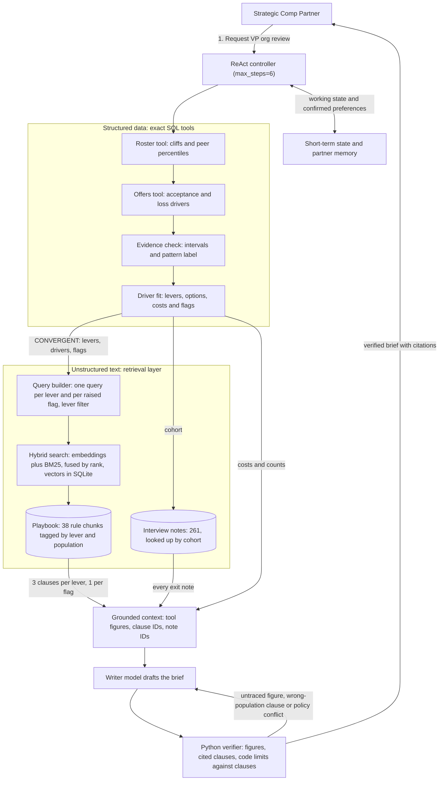

# Checkpoint 3.1: Retrieval design and data grounding

## System architecture diagram

## Written submission

### 1. Does the agent need retrieval?

Yes for policy text and interview notes, and no for numbers. The agent answers three kinds of questions:

- **How many and how much.** Cliff counts, acceptance rates, costs and budgets come from SQL over the synthetic roster, offers log and budgets. Similarity search would return rows that look alike, not the right total, so numbers stay in SQL and text goes to a vector store, as Jesse Barkley advised in the Week 2 office hour.
- **What the rules allow.** Approvals, raise limits and required disclosures live in the 1,869-word governance playbook. No model learned them, because the company is synthetic, and they change. Section 6 arrived on Oct 22, after the 2.1 grading.
- **Why people left.** 261 synthetic exit and stay interview notes give reasons in the employees' own words. SQL filters them by cohort but can't rank them by meaning.

Lecture Slide 61 says to include a small corpus whole and to retrieve when it is large, frequently updated or expensive to include. The playbook is small but it changes, and a real deployment adds interview notes every quarter. A whole playbook also puts every limit in front of the writer at once, 1.00 and 1.20 for new-hire offers and 0.80 and 0.95 for current pay. Our Checkpoint 2.1 draft cited "the 1.20 post-grant compa-ratio cap", which the playbook doesn't contain. Its only 1.20 belongs to the new-hire clause. Retrieval sends only the clauses for the lever at hand. The full-playbook prompt stays as an untested baseline that retrieval has to beat in the Checkpoint 7.1 evaluation.

### 2. How semantic retrieval fits into the loop

The external sources are the playbook, cut into 38 rule-sized chunks, and the 261 notes. An open embedding model, `nomic-embed-text` served locally by Ollama, turns each chunk into a vector. SQLite stores the vectors with the model name and a hash of the playbook, so a changed playbook or model triggers a rebuild. A BM25 index covers the same chunks, and reciprocal rank fusion merges the two rankings, because dense vectors catch paraphrases while keyword search still wins on exact terms such as "Tier 0", as the DPR paper found. Metadata filters run first.

After the evidence check returns `CONVERGENT` and the driver-fit tool names the levers in play, the agent:

1. sends one query per lever, written in playbook terms from the lever and the cohort's loss drivers and filtered to that lever's clauses;
2. sends one query for each checklist item a tool flag raises;
3. fetches every exit note for the cohort by metadata, since the brief needs all of them, not the nearest five.

The writer model sees only the tool figures, the clauses and the notes, and it cites their IDs. BM25 needs no model, so the default run and the 99 unit tests work offline.

### 3. How retrieval changes the brief

`VP_CLOUD_AI` research scientists, the case the 2.1 graders raised, show the change. The tools return the same numbers either way. Of 4 departures after a counter-offer, 2 cite level, 1 base salary and 1 equity. Option A fits the $2,150,000 remaining budget at $1,524,000 but addresses 1 departure, and Option C addresses all 4 at $4,006,600.

| Checklist item from the tools | Without retrieval | With retrieval |
| :--- | :--- | :--- |
| Grants address 1 of 4 departures | Unsupported | Section 6.1, a grant "changes neither base salary nor level" |
| 4 departures, below the minimum of 5 | Unsupported | Section 6.5, state counts instead of percentages and name the data that would settle it |
| 5 employees below the floor, $21,100 to fix | Unsupported | Section 6.2, no base salary below a 0.80 compa-ratio |
| 9 level review candidates, $1,078,000 a year | Unsupported | Section 6.3, the people manager and the calibration committee decide |
| Option C is $1,856,600 over budget | Unsupported | Section 6.2, adjustments above the remaining budget need VP sign-off |

Without retrieval, the verifier blocks each unsourced rule, so the brief gives numbers without the rules behind them. With retrieval, all 5 items cite a clause, and the 4 exit notes add reasons such as EXIT-0024, "The counter-offer added stock but left my salary where it was." The brief separates the drivers, matches each to its lever and shows the trade-off with its rules, as the graders asked. `python3 -m src.retrieval.grounded_options --compare` prints both columns.

Retrieval also picks up policy changes without retraining, as the RAG paper showed by swapping its 2016 index for a 2018 one. In a playbook copy that lowers the raise ceiling from 0.95 to 0.90, no clause states the code's 0.95 any more, so the agent reports a conflict and stops costing Option C's base lifts.

### 4. Retrieval design choices

- **Sources.** The playbook for rules, the notes for reasons and SQL for tables.
- **Segmentation.** One chunk per rule, meaning each bullet, numbered item or paragraph, plus the lever table. The lecture's usual 800 to 1,000 tokens would hold a third or more of the playbook and mix the rules it warned against mixing. The 38 chunks run 13 to 161 words, with a median of 30.5. Search reads each chunk with its section heading in front, as DPR puts the article title before each passage, and tags record its levers and population. On 24 test questions, rule chunks and 120-word windows with 30 words of overlap each found the right clause in the top 3 for 11. The windows carried 133 words of context on average against 47, and a window spans up to 5 rules, so a citation can't point to one.
- **How many results.** 3 clauses per lever, inside the lecture's usual 2 or 3, plus 1 per checklist item and every exit note in the cohort. A larger k adds recall but also noise and tokens, so when a limit the code applies is missing from the 3, an exact lookup adds its clause instead, as it did for the level review's 2-year rule and the Tier 0 rule for grants.
- **When to return nothing.** A clause must match half of the query's terms or clear a similarity threshold. A quarter raised the score on the 16 tuning questions from 8 to 12, but on 8 held-out questions it still found 3 and answered a question the playbook doesn't cover. Lab 3.2 warned against tuning on the test set, so the bar stays at half, and all 4 unanswerable questions return nothing.

### 5. Failure mode: a relevant clause for the wrong population

The lecture called this a similarity trap, where high similarity means shared vocabulary, not the correct answer. In the playbook it appears as two populations. Section 2.1 lets the Offers Desk approve new-hire offers up to a 1.00 compa-ratio and 1.20 times the equity guideline, and Section 6.2 caps raises for current employees at 0.95. Asked "Is there a compa-ratio cap for equity?", BM25 ranks the new-hire clause first, and a writer that reads it can repeat our 2.1 error. Embeddings can make it worse, because the two clauses mean nearly the same thing.

Three checks manage the risk:

1. **Filters.** Chunks carry their levers and population, and the agent's queries filter on the lever, so a retention query never sees Section 2.1. A playbook section without tags fails a unit test.
2. **Clause verification.** Slide 29 calls a nearby vector "a candidate, not proof". Each rule in a draft cites a clause ID, and a Python check confirms that each number appears in that clause and that the clause governs the lever. "1.20" for a retention grant fails, because it appears only in a new-hire clause.
3. **Code against policy.** Tools compute every dollar, and the limit check confirms that each limit the code applies, such as the 0.95 lift ceiling or the ratings Tier 0 excludes from grants, appears in a clause for that lever.

Keyword search found the right clause for 11 of the 24 answerable questions, and all 13 misses use a partner's words rather than the playbook's. "Lowest pay relative to market for current staff" returns nothing, for example. The embedding model is there to close that gap, and Slide 54's comparison of dense, keyword and hybrid search on the same questions is the next measurement.
