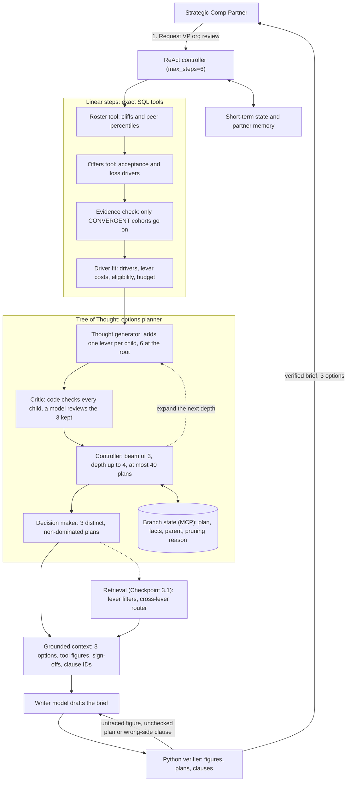

# Checkpoint 4.1: Tree-of-Thought integration plan

## System architecture diagram

## Written submission

### 1. Does the agent need Tree-of-Thought reasoning?

Yes, at one step, and nowhere else. The SQL tools, the evidence check and retrieval are lookups with one right answer, so branching there would add model calls without adding accuracy. The tree goes where the playbook already asks for "Branching Intervention Options (Tree-of-Thought Trade-Offs)", three costed options for a cohort's loss drivers under a budget.

### 2. Where the tree runs and why a chain fails there

After the evidence check returns `CONVERGENT`, the agent picks which levers to combine: retention grants in three sizings, base lifts, level reviews and the new-hire band review. A linear chain commits early. The evidence says "cliff", so it starts with the default lever, a retention grant, and never revisits that choice. In Yao et al.'s Game of 24, about 60% of chain-of-thought samples failed at step one. For research scientists, grants spend $1,524,000 of the $2,150,000 left, level reviews no longer fit, and the chain ends at 2 of 4 departures. Only 1 of the 4 cited equity.

The constraints also interact. Tier 0 and eligibility decide who can receive each lever, sign-offs depend on cost and tier, and costs don't add: 7 of the 9 level-review candidates also qualify for a base lift, which a promotion makes unnecessary.

We measured this on the three cohorts that pass the evidence check, with the same code checks in every column, best plan inside the remaining budget:

| Cohort | Template options | Grant-first chain | Tree |
| :--- | ---: | ---: | ---: |
| Research scientists | 1 of 4, $1,524,000 | 2 of 4, $1,804,600 | 3 of 4, $1,236,800 |
| AI/ML engineers | 6 of 7, $1,715,000 | 7 of 7, $2,009,200 | 7 of 7, $2,009,200 |
| Cyber security engineers | 3 of 5, $2,142,000 | 4 of 5, $2,574,400 | 4 of 5, $2,574,400 |

For AI/ML and cyber, two of the three templates were one plan at one price. A chain that scores every step, instead of starting from grants, finds the tree's top plan in all three cohorts. So the tree earns its place through the option set. The brief needs three distinct, checked plans with their trade-offs, and a chain returns one.

### 3. The tree

- **Thought.** One decision that extends a plan, such as "lift base to the 0.95 ceiling for the 18 eligible scientists".
- **Node.** A plan so far, with the facts the tools compute for it: departures and declined offers addressed, first-year cost, budget fit and required sign-offs.
- **Branch and depth.** A branch is a sequence of decisions. Depth is the number of levers decided, at most 4, one per lever.
- **Branching factor.** 6 at the root, because grants come in three sizings, then at most 5, 4 and 3.
- **Termination.** The search stops at depth 4, when no child adds coverage, or after 40 evaluated plans. The decision maker then picks three distinct plans that no other plan beats on coverage, cost and sign-offs at once: the most coverage inside the budget, the most coverage at any cost, and the cheapest plan that answers at least half the departures.

For research scientists that gives 3 of 4 departures for $1,236,800, 4 of 4 for $2,760,800, $610,800 over budget with VP sign-off, and 2 of 4 for $1,078,000.

### 4. Search and evaluation

**Strategy: beam search, width 3.** It is Yao et al.'s breadth-first search with a breadth limit, which the Lab 4.1 notebook calls a beam. Exhaustive search suits one cohort's 32 plans, but the org-level brief combines three cohorts, 32,768 plans, and a model critic call per node would cost too much. A beam of 3 matches the brief's three options and evaluated 24 to 27 plans per cohort. Depth-first search dives down one branch, the chain's failure, and Monte Carlo sampling adds variance where code computes every number. A beam is also the simplest to build and test, one loop and one ranking rule.

**Who evaluates.** Code checks every child. A reasoning model reviews only the three plans kept at each depth, for risks code can't score, such as a manager inversion flag. That caps cost at 12 calls and latency at 4 parallel rounds per cohort. The model can demote a plan with a reason, but never prunes one or changes a number.

**Pruning and failure conditions.**

1. A lever with no eligible employee addresses nothing.
2. A child that adds no departure or declined offer is dropped.
3. Two paths to the same plan are evaluated once.
4. A plan that covers no more and costs more than another isn't offered.
5. A lever whose limit no retrieved clause states is a policy conflict, so the agent stops costing it.
6. When no plan fits the budget, the brief offers the cheapest plan that answers at least half the departures and flags VP sign-off.

**Ties.** Inside the budget first, then more departures, more declined offers, fewer sign-offs, lower cost and fewer levers.

### 5. Roles mapped to tools

| Role | Tool | Why |
| :--- | :--- | :--- |
| Thought generator | CrewAI agent on a fast model | Picks the next decision from the six playbook actions. The code enumerator is its test oracle |
| Critic | Python checks as MCP tools, plus a CrewAI critic on a reasoning model | Code owns every figure. The model judges what code can't |
| Decision maker and controller | LangGraph (LangChain) state graph | Runs the beam loop, stopping rules and selection policy as testable steps |
| Memory and state | MCP server | Holds each branch's plan, facts, parent and pruning reason, so all agents read one state and the partner sees why a plan was dropped |

### 6. Failure mode: weak evaluation signals

A critic that scores the wrong signal prunes good plans or keeps empty ones. Yao et al. saw the first failure in crosswords: without pruning, ToT found the right board in 4 of 20 games, 3 of which the pruned search missed within 100 steps. The template options score a lever by the drivers it addresses, not by who can receive it. In 8 of the 13 cohorts with departures, at least one template "addresses" departures for $0 because nobody qualifies. Only the evidence check stops them today. The planner prunes only in code, on the facts in Section 4. It checks eligibility and prices plans per employee, unit tests pin both, and it logs each pruned plan's reason.

### 7. Feedback from Checkpoint 3.1

The graders asked how the agent answers "Compare the equity caps for new hires versus current staff" without breaking its single-lever filters. One unfiltered search returned neither cap. The agent now runs one query per side, each inside a strict population and lever filter, and the writer sees one labeled group per side. So the new-hire limit, 1.20 times the equity guideline, and the Tier 3 ceiling for current staff, 150% to 200% of the refresh guideline, can't trade places. On 7 held-out comparisons, keyword search answered 5 of 11 sides against 0 with one query, and the verifier rejects a clause from the wrong side.
