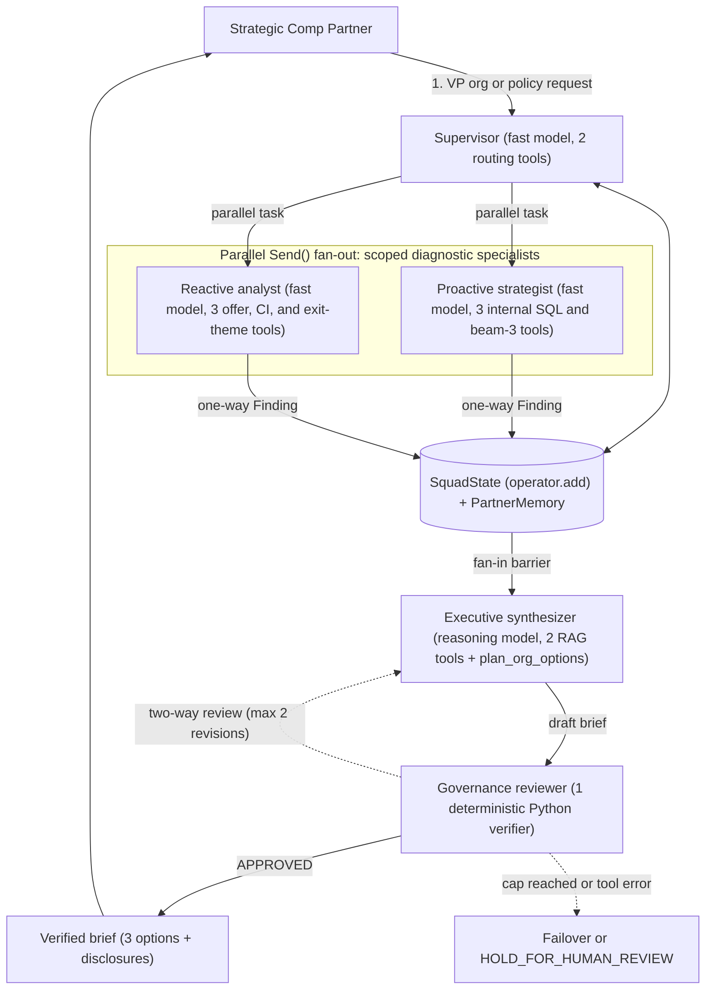

# Checkpoint 5.1 multi-agent architecture and coordination plan

## System architecture diagram

## Written submission

### 1. Problem and why one generalist agent fails

The advisor builds executive compensation briefs for Apex Cloud & AI Corp partners from SQLite equity cliffs, offer losses, exit notes, policy clauses, and partner preferences. Giving one generalist agent all 12 tools across three stores creates 66 tool-pair choices, runs 15 sequential rounds, and prices `VP_CLOUD_AI` cohorts separately. Its standalone `RESEARCH_SCI` and `AI_ML_ENG` plans sum to $3,246,000, overrunning the shared $2,150,000 proactive budget by $1,096,000. Multi-agent separation scopes each toolset, runs internal and external diagnostics in parallel, composes one shared budget, and isolates verification from drafting.

### 2. Five-agent squad and role boundaries

The squad uses five agents inside Guo et al.'s three-to-five sweet spot before channels reach `n(n-1)/2 = 15` at six agents. Roles split only where permissions, corpora, parallelism, or independent checks differ:

- `supervisor` parses scope, loads `PartnerMemory`, and dispatches tasks on a fast model.
- `proactive_strategist` runs three SQLite and beam-3 tools for cliffs, eligibility, and cohort Pareto fronts.
- `reactive_analyst` runs three offer-loss, confidence-interval, and exit-theme tools.
- `executive_synthesizer` runs two filtered policy tools, composes cross-cohort budgets on a reasoning model, and drafts the brief.
- `governance_reviewer` runs one Python verifier across figures, clauses, and disclosures without drafting.

### 3. Hybrid graph coordination and execution flow

A hybrid LangGraph `StateGraph` governs execution so nodes write state flags while conditional edges only read flags. After scope validation, `supervisor` fans out via parallel `Send()` branches to `proactive_strategist` and `reactive_analyst`, halving diagnostic latency and scaling across cohorts. Both branches meet at a fan-in barrier before `executive_synthesizer` calls `plan_org_options()` to compose `VP_CLOUD_AI`'s joint $1,995,600 plan, covering 7 of 11 departures and 16 of 16 declined offers with $154,400 headroom. Tool exceptions route to `failover`, verified briefs route to `finalize`, and unresolved review cycles route to `HOLD_FOR_HUMAN_REVIEW`.

### 4. Shared-pool communication and bounded feedback

Agents exchange typed objects through a `SquadState` shared message pool rather than free-form chat. Parallel specialists publish `Finding` records through Python's `operator.add` list-append reducer so concurrent writes never collide, while `PartnerMemory` injects confirmed preferences into `supervisor` and `executive_synthesizer`. Communication modes match each step's cost and risk. Specialists use one-way state broadcast for speed. `executive_synthesizer` and `governance_reviewer` use a two-way review loop carrying missing figures or wrong-side clause IDs for redrafting. Option search runs as width-3 beam pruning inside `proactive_strategist` instead of open multi-agent brainstorming.

### 5. Reliability, complexity, and overhead trade-offs

Five chained agents at 95% step accuracy drop to `0.95^5 = 77.4%` reliability when unverified prose passes down a line. Parallel specialist grounding plus an independent deterministic verifier breaks that serial chain at the cost of explicit state schemas and routing edges. To cap overhead and block recursive doom loops, `ScopedToolExecutor` rejects out-of-role or duplicate tool calls, retrieval rewrites stop at `MAX_RETRIEVAL_ATTEMPTS = 2` per lever, and review loops stop at `MAX_REVISIONS = 2`. That completes `VP_CLOUD_AI` in 7 messages and 22 tool calls while `ThreadCheckpointer` snapshots every step.

### 6. Feedback from `Checkpoint 4.1`

The `Checkpoint 4.1` graders asked us to test width-3 beam pruning against exhaustive search across a cohort's 32 unique plans and justify multi-cohort limits. Across the three `CONVERGENT` cohorts, exhaustive search runs 96 code checks and 93 model calls to find 15 Pareto plans. Width 1 uses 42 checks and 11 calls yet misses 10 declined offers on `AI_ML_ENG` Option 3 and 44 of 105 budget thresholds. Width 2 drops `CYBER_SEC_ENG`'s $1,261,200 plan and misses 17 thresholds. Width 3 uses 76 checks and 30 calls, matching all 9 options, 15 Pareto plans, and 105 sweeps, while two-stage composition matches `VP_CLOUD_AI`'s 1,024-plan optimum in 85 checks and 22 calls where a flat 40-plan cap misses all 3.
