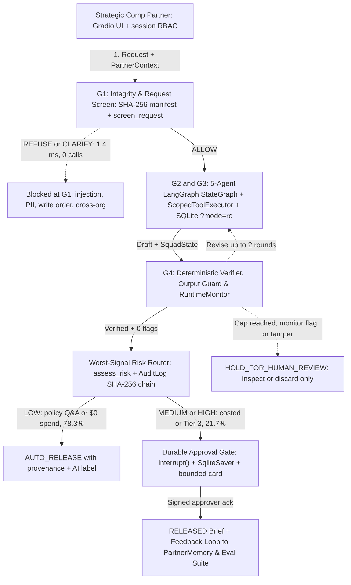

# Checkpoint 6.1 safety guardrails and human intervention plan

## System architecture diagram

## Written submission

### 1. Purpose and workflow risks

The advisor runs a five-agent LangGraph `StateGraph` behind a Gradio console to draft cohort retention briefs, reactive-offer diagnostics, and cross-lever policy comparisons on synthetic Apex Cloud & AI Corp data. Five workflow risks threaten safe operation: prompt injections or requests for individual pay, protected traits, and write actions; cross-organization data leaks across compensation partners; fabricated or swapped currency figures, headcounts, and percentages; wrong-population policy citations, such as applying new-hire caps to staff grants; and overconfident spend commitments issued without executive sign-off.

### 2. Layered safety guardrails

Following the MAESTRO defense-in-depth blueprint and Baker et al.'s finding that chain-of-thought monitors fail under obfuscation, Python code enforces every guardrail on states and outputs rather than soft prompt instructions:

- **Pre-execution at `G1`.** `verify_manifest()` checks the playbook's SHA-256 digest before execution, and `screen_request()` blocks prompt injections, individual pay queries, protected traits, write orders, out-of-scope prompts, and cross-org requests in `1.4 ms` with zero tool calls.
- **Tool and state locks at `G2` and `G3`.** `ScopedToolExecutor` enforces session-bound `allowed_orgs`, limits each role to one to three tools, and blocks duplicate calls. Roster SQLite connections open read-only via `?mode=ro`, while `PartnerMemory` blocks `POLICY_LOCKED` overrides and requires preview-and-commit confirmation.
- **Output and trajectory checks at `G4`.** `deterministic_verify_brief()` and proposition-based `check_brief()` reject ungrounded numbers, swapped option costs, missing side-matched clauses, `EMP_` IDs, outcome guarantees, and approval claims across at most `MAX_REVISIONS = 2` redrafts. `review_trajectory()` checks node transitions and call budgets, while `AuditLog` writes a SHA-256 hash chain.

### 3. Workflow evaluation metrics

`src/guardrails/evaluate.py` tracks five multi-scenario metrics aligned with HELM:

- **Request boundary precision and recall.** Across 136 cases in four splits, the screen refuses `0 of 50` benign requests, reaches `40 of 48` or `83.3%` single-pass accuracy on an untouched adversarial split `held_out_2`, and contains `10 of 10` leaked violations downstream.
- **Numeric and policy groundedness.** All `23 of 23` clean briefs pass, and `155 of 160` or `96.9%` of seeded numerical, citation, PII, and promise faults are rejected.
- **Trajectory monitor accuracy.** Clean runs trigger `0` false alarms while `7 of 7` seeded trace faults are flagged.
- **Escalation rate.** Across `23` workflow runs, `18` or `78.3%` auto-release and `5` or `21.7%` escalate to human sign-off.
- **Latency overhead.** Controls add `53.4 ms`, moving median runtime from `75.8 ms` to `129.1 ms`.

### 4. Risk routing and human intervention criteria

Instead of one universal gate, `assess_risk()` takes the worst signal across verification, monitor flags, spend, and playbook triggers to select four lanes. `AUTO_RELEASE` publishes cited policy comparisons and zero-spend briefs for `VP_ENT_APPS` and `VP_INFRA_SRE`. `PARTNER_APPROVAL` pauses in-budget cohort options without executive exceptions. `EXECUTIVE_SIGN_OFF` pauses runs via LangGraph `interrupt()` in SQLite when an option triggers Tier 3 grants requiring `VP` and `Head of Compensation`, over-budget spend requiring `VP`, level reviews requiring `Calibration committee`, or policy conflicts requiring `Compensation governance`, refusing `9 of 9` unacknowledged approvals. `HOLD_FOR_HUMAN_REVIEW` quarantines unverified drafts, tool errors, monitor flags, or hash mismatches for inspection or discard only.

### 5. Closed-loop strategy and design trade-offs

Guardrails, metrics, and selective oversight form one closed loop. Code locks block irreversible actions, risk routing preserves autonomy and efficiency on `78.3%` of runs while focusing human oversight on `21.7%` high-impact briefs, and reason-coded reviewer edits such as `wrong_option_order` feed `PartnerMemory` proposals and new regression cases in `guardrail_cases.json`. Choosing deterministic rules over an LLM judge trades paraphrase recall at `G1`, where `8 of 30` disguised prompts pass `G1` before downstream scopes contain them, and existence-only percentage checks, which miss `5 of 160` faults when a swapped percentage already appears in tool output, for zero token cost, `53.4 ms` latency, and reproducible deployment reliability.
