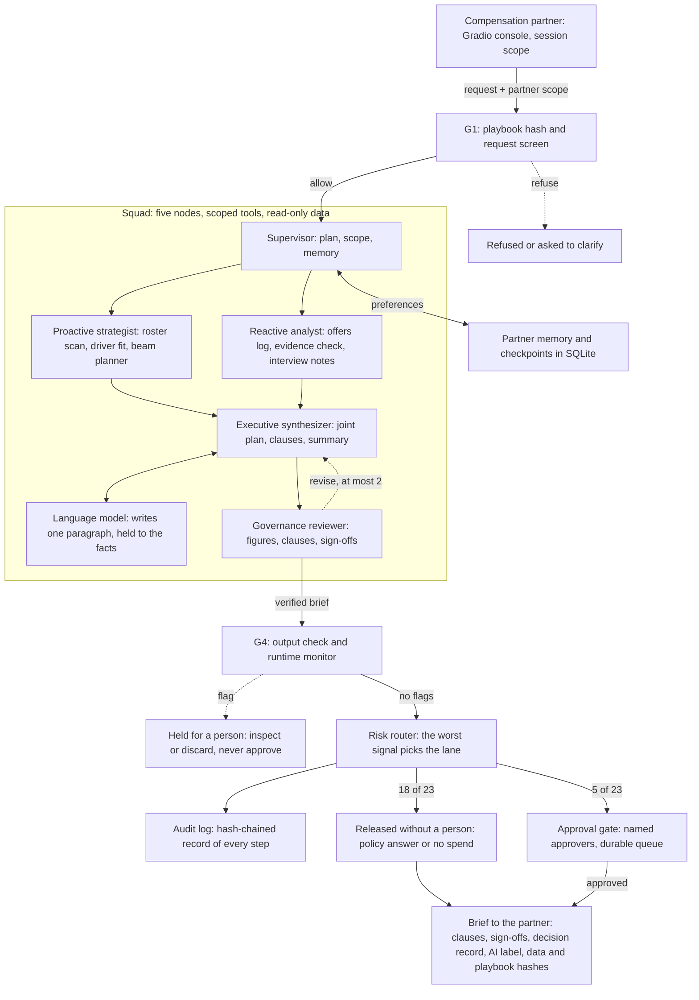

# Checkpoint 7.1 final capstone report

GitHub repository: https://github.com/pedrogriff/comp-insight-advisor

Video presentation: https://youtu.be/YprdRwfI1LU

## System architecture diagram

## Written submission

### 1. Project title

Strategic Talent and Compensation Insight Advisor, a guarded multi-agent research assistant for compensation partners.

### 2. Problem and user

The user is a compensation partner preparing a quarterly retention and offer review for a VP. The partner joins four sources by hand: a roster that shows whose cash flow drops when equity runs out, a log of offers and counter-offers, exit and stay interview notes, and a governance playbook of 38 rules. Everything has to fit one department budget, and one wrong figure in front of a VP costs the partner's credibility.

A chat assistant doesn't solve this, and I measured why. Given 500 roster rows, a model answered a count question right in 0 of 5 runs. Dividing in text, it matched the stored compa-ratio for a median of 297 of 300 employees. Asked whether equity has a compa-ratio cap, keyword and hybrid search ranked the new-hire offer rule first, the wrong population for a retention brief. Two teams also share one budget, and the best plan for each, priced separately, adds up to $3,246,000 against $2,150,000.

All data is synthetic. Apex Cloud & AI Corp has 2,000 employees, 4 VP orgs, 350 offer events and 261 interview notes, and it doesn't exist.

### 3. System goal and scope

**Goal.** From one request, the advisor drafts a brief the partner can take to a VP: the evidence, up to three costed options, the playbook clause behind each, and the sign-off each needs.

**Design rationale.** Counting, dividing, filtering by population and fitting a budget are jobs code does exactly. So models write the words, code computes the money, and people decide.

**Evaluation criteria.**

1. Every dollar figure, percentage and coverage count in a brief traces to a tool output.
2. Every cited rule belongs to the population the brief is about.
3. Each option fits the budget or names who approves the overrun.
4. Nothing that commits spend reaches a VP without a person's decision.
5. The advisor refuses unsafe requests and answers legitimate ones.

**Scope and constraints.** The advisor reads and never writes, so a release is a document and no pay record changes. It answers about cohorts and refuses questions about one person's pay. If no model is configured or reachable, code writes the summary, so a brief never waits on a provider.

### 4. Final system architecture

G1 comes first. It checks the playbook's hash and screens the request for prompt injection, questions about one person's pay, protected attributes, write orders and orgs outside the partner's scope, before any tool or model runs.

Five nodes then run as a LangGraph `StateGraph` and pass typed state, never chat history. The supervisor plans the run and loads the partner's standing preferences. Two specialists run in parallel. The proactive strategist scans the roster, matches each reason for leaving to the lever that addresses it and searches lever plans with a beam of width 3. The reactive analyst reads the offers log, puts 95% intervals on its rates and searches the interview notes. The executive synthesizer composes one plan per org under the shared budget and retrieves each lever's clauses, filtered by lever and population. The governance reviewer checks every figure, clause and sign-off against the tool outputs and sends a failed draft back at most twice.

The graph calls a language model at one point, the summary paragraph, because wording is the one step with no exact answer. The model gets code-written facts, and code rejects a draft that adds a number or a forbidden claim. After two rejected tries, the brief keeps the code-written paragraph. Every other decision is code.

G4 then checks the output and the run's trace, and a risk router picks a lane. It releases a cited policy answer or a brief with no spend. A costed brief waits at an approval gate for the approvers the playbook names. Any flag holds the run for a person.

### 5. Design evolution across the program

| Module | What I added | What feedback or a measurement changed |
| :--- | :--- | :--- |
| 1 | One agent on paper | Graders asked about thin or conflicting data. I added an evidence check with intervals, and memory across sessions |
| 2 | SQL tools that return summaries, not the raw roster | Graders asked me to separate why people leave. A driver-fit tool matches each reason to a lever |
| 3 | 38 tagged clauses and filtered retrieval | Graders asked about questions that span populations. A router runs one filtered query per side |
| 4 | Tree-of-Thought beam search over lever plans | Graders asked whether pruning loses good plans. I tested the beam against exhaustive search |
| 5 | Five nodes with scoped tools, one plan per org | My benchmark showed the saving comes from composing teams under one budget, not from the number of agents. Graders asked how shared state protects pay data. The roster scan was passing on rows with employee IDs, and tools now hand over counts only |
| 6 | Guardrails, approval gate, audit log, console | Graders suggested counting what sends briefs to review, which the scorecard now does, and an embedding screen for reworded attacks, which is the next test. The final evaluation found that policy answers skipped the figure check. I fixed it and added 3 seeded faults |

Two designs changed. Tree of Thought became a search that code scores, because every plan's cost and coverage are computable. Multi-agent became five nodes with at most 3 tools each, because I can test a node with a narrow job on its own.

Three course methods are left out on purpose. No model picks a tool or reasons step by step, because every decision in this workflow has an answer code can check. Nothing is fine-tuned, because pay facts belong in tools. And the advisor is not packaged as a plugin, because its user works in the console.

### 6. Implementation overview

The core is Python 3.12 with the standard library: `sqlite3` opened read-only for the roster tools, BM25 and reciprocal rank fusion for retrieval, and JSON files for test cases. LangGraph supplies the `StateGraph`, `Send()` for the parallel branch, `SqliteSaver` for checkpoints and `interrupt()` for the approval gate. A standard-library engine runs the same nodes when LangGraph is absent. Gradio serves a three-tab console. Embeddings come from `nomic-embed-text` through Ollama, and saved scores replay them offline. The summary writer calls any OpenAI-compatible chat endpoint or a local Ollama server, and `src/models/router.py` names the models. For the recorded run I chose a small model, `gemini-3.5-flash-lite`, because code supplies every fact and the model only words them.

### 7. Evaluation and results

Every component has cases with a known right answer. One command, `python3 -m src.evaluation.scorecard`, reruns them all and compares the counts with the committed scorecard. A test checks this report's dollar figures, percentages and N-of-M counts against that file.

| Question | Result |
| :--- | :--- |
| Does retrieval find the right clause? | 11 of 24 questions with keyword search, 24 of 24 with dense search, 23 of 24 with hybrid search |
| Does a comparison get both sides? | 9 of 11 held-out sides with one query per side, against 5 of 11 with a single query |
| Does the beam match exhaustive search? | 9 of 9 options at 105 of 105 budget levels, with 67.7% fewer critic reviews planned |
| Does composing teams fit the budget? | $1,995,600 for 7 of 11 departures, against $3,246,000 with each team priced alone |
| Does the screen refuse the right requests? | 0 of 50 benign requests refused, 40 of 48 right on an unseen split |
| Do later layers contain what the screen misses? | 10 of 10, through scoped tools, the verifier and the approval route |
| Do the checks catch a wrong brief? | 158 of 163 seeded faults rejected, 23 of 23 clean briefs passed |
| How often must a person look, and why? | 5 of 23 requests waited for sign-off, 21.7%. The signals: an unreconciled budget ledger in 5 of 5, a Tier 3 grant in 5 of 5, a level decision in 4 of 5 |
| Does shared state stay at cohort level? | 0 of 23 final states and 0 of 3 stored files name an employee |
| Does a real model's paragraph pass? | With `gemini-3.5-flash-lite` writing, 22 of 23 runs ended on its first draft and 1 of 23 on its redraft |

The checks hold whatever the model writes. A stand-in model that invents a figure in every draft ended 23 of 23 runs on the code-written paragraph, with the route unchanged. In the recorded run the fact check rejected 1 draft, which promised a guaranteed outcome, and the model's redraft passed. All 23 of 23 runs ended on the route of the code-written run. The tests replay those saved drafts against today's checks.

### 8. Safety and reliability considerations

Code enforces every control, because a prompt is advice a model can ignore. Tools open the database read-only and accept only the orgs in the partner's session. They hand over counts, averages and totals, so the state the nodes share holds no row about one employee, and the monitor holds any run whose state names one. The model sees only the code-written facts. A hash guards the playbook, and a changed file stops the run. The reviewer, the output check and the monitor reject wrong figures, wrong-population clauses, employee IDs, promises and decision claims.

When sources disagree, code doesn't pick a side. The evidence check asks whether the roster and the offers log agree, and only a cohort where both show risk gets costed options. A rate whose 95% interval straddles its threshold counts as inconclusive, and the brief discloses it. A limit that no retrieved clause states is reported as a policy conflict and adds compensation governance as an approver.

Retries are bounded: one redraft for the model and two revisions for the reviewer. A third failure, a tool error or any flag holds the run for a person, who can inspect or discard it but never approve it. The gate refused 9 of 9 invalid approvals, and a waiting brief survives a restart. An audit log chains every step by hash, so an edit to any line shows. Each release carries the approver's decision, a label saying an AI assistant drafted it, and the hashes of the data and the playbook.

### 9. Limitations and next steps

- The data is synthetic, and no partner has used the advisor. The guardrails are tested on seeded faults, not validated on real requests. A pilot on masked data comes first.
- The screen let 8 of 30 unseen violations through. Later layers contained them. The graders suggested an embedding screen that compares a request with known attack patterns, and that is the next test.
- The 5 missed faults are invented percentages that match a number elsewhere in the tool output. Binding each figure to its claim would close that gap.
- The checks read numbers, clauses and banned phrases. A reworded sentence with no number can still be wrong.
- One model call is a narrow use of a model, and one recorded run on one model stands behind it. Reading the org and team from free text, checked against the partner's scope, is the next place for a model.

### 10. Public GitHub repository

The repository is public at https://github.com/pedrogriff/comp-insight-advisor. Its README explains the problem, the architecture, setup and usage. A section named "Review in five minutes" lists what to read on GitHub with nothing installed, maps each part of the video to its code, and gives four commands: the tests, the scorecard, the console and one guarded brief. `experiments/final_evaluation/` holds the scorecard, sample outputs and the recorded model run, and `checkpoints/` holds all seven write-ups.
